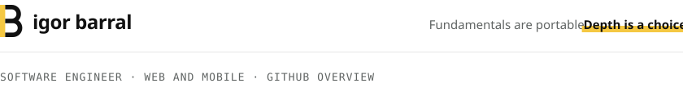
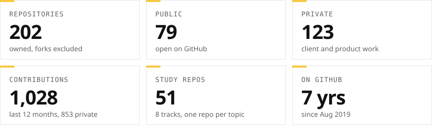
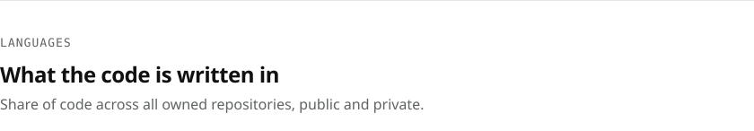
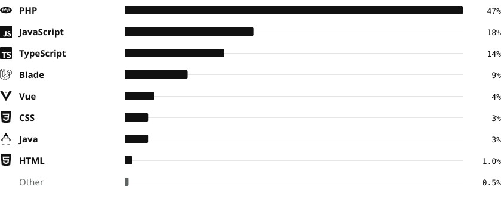
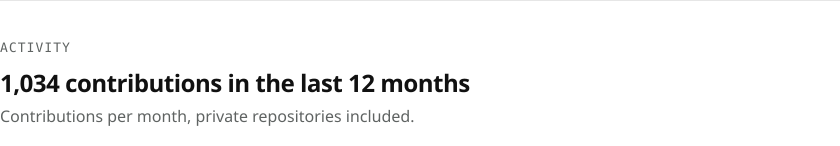
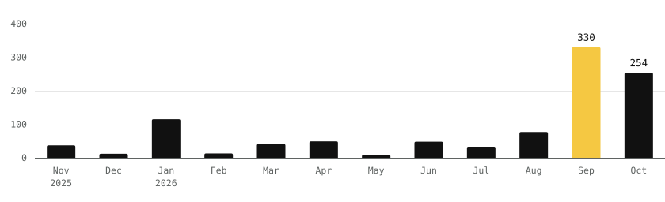
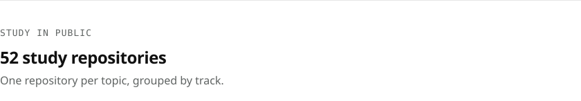
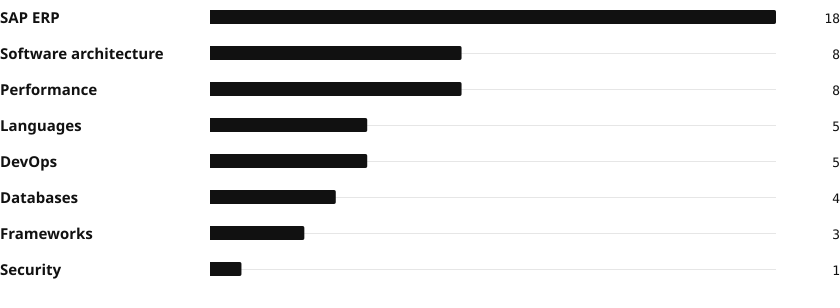
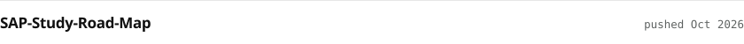
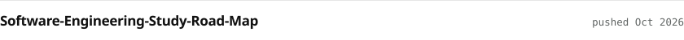

<!-- Generated by `npm run build` from the GitHub API and src/content.mjs. Do not edit by hand. -->

<a href="https://igorbarral.com.br"><picture><source media="(prefers-color-scheme: dark)" srcset="assets/header-dark.svg"></picture></a>

<picture><source media="(prefers-color-scheme: dark)" srcset="assets/tiles-dark.svg"></picture>

<picture><source media="(prefers-color-scheme: dark)" srcset="assets/languages-head-dark.svg"></picture> 
<picture><source media="(prefers-color-scheme: dark)" srcset="assets/languages-dark.svg"></picture>

<picture><source media="(prefers-color-scheme: dark)" srcset="assets/activity-head-dark.svg"></picture> 
<picture><source media="(prefers-color-scheme: dark)" srcset="assets/activity-dark.svg"></picture>

<picture><source media="(prefers-color-scheme: dark)" srcset="assets/study-head-dark.svg"></picture> 
<picture><source media="(prefers-color-scheme: dark)" srcset="assets/study-dark.svg"></picture>

<picture><source media="(prefers-color-scheme: dark)" srcset="assets/recent-head-dark.svg"></picture> 
<a href="https://github.com/igor-barral/SAP-Study-Road-Map"><picture><source media="(prefers-color-scheme: dark)" srcset="assets/repo-sap-study-road-map-dark.svg"></picture></a> 
<a href="https://github.com/igor-barral/Software-Engineering-Study-Road-Map"><picture><source media="(prefers-color-scheme: dark)" srcset="assets/repo-software-engineering-study-road-map-dark.svg"></picture></a> 
<a href="https://github.com/igor-barral/php-turbo-admin"><picture><source media="(prefers-color-scheme: dark)" srcset="assets/repo-php-turbo-admin-dark.svg"></picture></a> 
<a href="https://github.com/igor-barral/canais-pipeline-site"><picture><source media="(prefers-color-scheme: dark)" srcset="assets/repo-canais-pipeline-site-dark.svg"></picture></a> 
<a href="https://github.com/igor-barral/languages-center-doc-notebook-lm"><picture><source media="(prefers-color-scheme: dark)" srcset="assets/repo-languages-center-doc-notebook-lm-dark.svg"></picture></a>

<a href="https://igorbarral.com.br"><picture><source media="(prefers-color-scheme: dark)" srcset="assets/link-site-dark.svg"></picture></a>&nbsp;
<a href="https://www.linkedin.com/in/igorbarrall"><picture><source media="(prefers-color-scheme: dark)" srcset="assets/link-linkedin-dark.svg"></picture></a>&nbsp;
<a href="https://youtube.com/@igorbarralltech"><picture><source media="(prefers-color-scheme: dark)" srcset="assets/link-youtube-dark.svg"></picture></a>

Data as tables

| Language | Share |
| --- | ---: |
| PHP | 47.4% |
| JavaScript | 18.1% |
| TypeScript | 13.9% |
| Blade | 8.8% |
| Vue | 4.0% |
| Java | 3.2% |
| CSS | 3.2% |
| HTML | 0.9% |
| Other | 0.5% |

| Month | Contributions |
| --- | ---: |
| 2025-11 | 37 |
| 2025-12 | 12 |
| 2026-01 | 115 |
| 2026-02 | 13 |
| 2026-03 | 41 |
| 2026-04 | 49 |
| 2026-05 | 9 |
| 2026-06 | 48 |
| 2026-07 | 33 |
| 2026-08 | 77 |
| 2026-09 | 330 |
| 2026-10 | 250 |

| Study track | Repositories |
| --- | ---: |
| SAP ERP | 18 |
| Software architecture | 8 |
| Performance | 8 |
| Languages | 5 |
| DevOps | 5 |
| Databases | 4 |
| Frameworks | 3 |
| Security | 1 |

<picture><source media="(prefers-color-scheme: dark)" srcset="assets/footer-dark.svg"></picture>

