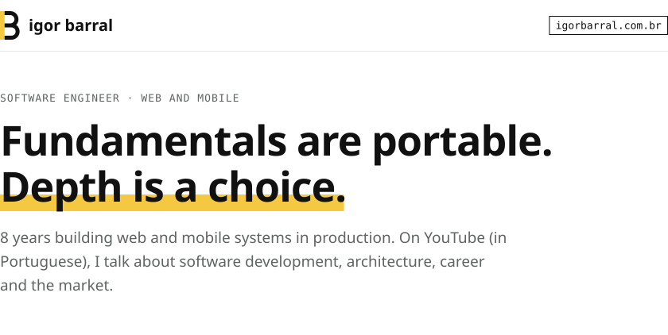
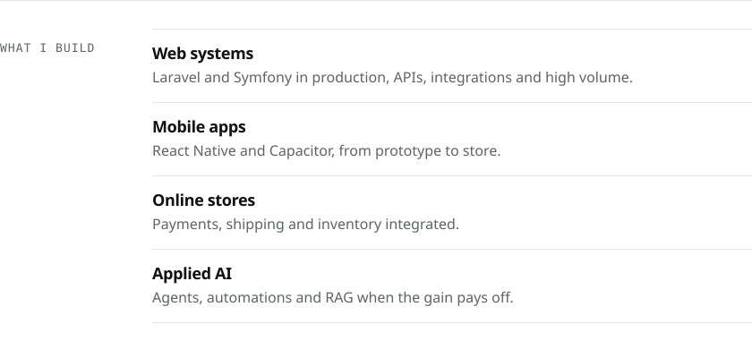
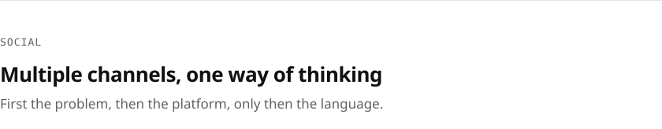

<!-- Generated by `npm run build` from src/content.mjs. Do not edit by hand. -->

<a href="https://igorbarral.com.br"><picture><source media="(prefers-color-scheme: dark)" srcset="assets/hero-dark.svg"></picture></a>

<picture><source media="(prefers-color-scheme: dark)" srcset="assets/build-dark.svg"></picture>

<picture><source media="(prefers-color-scheme: dark)" srcset="assets/projects-dark.svg"></picture> 
<a href="https://verohire.igorbarral.com.br"><picture><source media="(prefers-color-scheme: dark)" srcset="assets/project-verohire-dark.svg"></picture></a> 
<a href="https://iblinkguard.igorbarral.com.br"><picture><source media="(prefers-color-scheme: dark)" srcset="assets/project-iblinkguard-dark.svg"></picture></a> 
<a href="https://github.com/igor-barral/SAP-Study-Road-Map"><picture><source media="(prefers-color-scheme: dark)" srcset="assets/project-sap-roadmap-dark.svg"></picture></a> 
<a href="https://github.com/igor-barral/Software-Engineering-Study-Road-Map"><picture><source media="(prefers-color-scheme: dark)" srcset="assets/project-se-roadmap-dark.svg"></picture></a>

<picture><source media="(prefers-color-scheme: dark)" srcset="assets/channels-dark.svg"></picture> 
<a href="https://youtube.com/@igorbarralltech"><picture><source media="(prefers-color-scheme: dark)" srcset="assets/channel-yt-tech-dark.svg"></picture></a> 
<a href="https://youtube.com/@igorbarrallopina"><picture><source media="(prefers-color-scheme: dark)" srcset="assets/channel-yt-opinion-dark.svg"></picture></a> 
<a href="https://youtube.com/@igorbarrallvlog"><picture><source media="(prefers-color-scheme: dark)" srcset="assets/channel-yt-vlog-dark.svg"></picture></a>

<a href="https://www.linkedin.com/in/igorbarrall"><picture><source media="(prefers-color-scheme: dark)" srcset="assets/social-linkedin-dark.svg"></picture></a>&nbsp;
<a href="https://instagram.com/igorbarrall"><picture><source media="(prefers-color-scheme: dark)" srcset="assets/social-instagram-dark.svg"></picture></a>&nbsp;
<a href="https://tiktok.com/@igorbarralltech"><picture><source media="(prefers-color-scheme: dark)" srcset="assets/social-tiktok-dark.svg"></picture></a>&nbsp;
<a href="https://facebook.com/igorbarrall"><picture><source media="(prefers-color-scheme: dark)" srcset="assets/social-facebook-dark.svg"></picture></a>

<picture><source media="(prefers-color-scheme: dark)" srcset="assets/contact-dark.svg"></picture> 
<a href="https://igorbarral.com.br"><picture><source media="(prefers-color-scheme: dark)" srcset="assets/contact-button-dark.svg"></picture></a>&nbsp;&nbsp;
<a href="mailto:igormagno.dev@gmail.com"><picture><source media="(prefers-color-scheme: dark)" srcset="assets/contact-link-dark.svg"></picture></a>

<picture><source media="(prefers-color-scheme: dark)" srcset="assets/footer-dark.svg"></picture>

