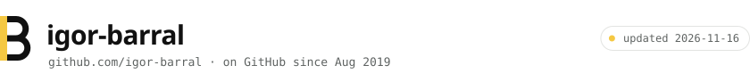
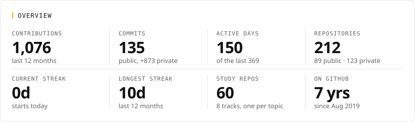
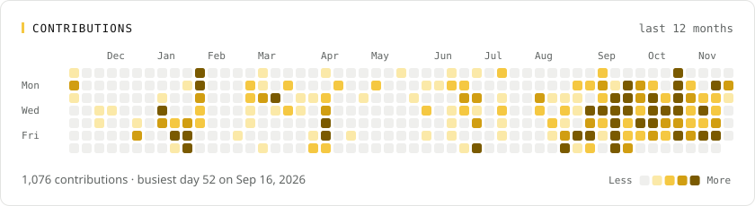
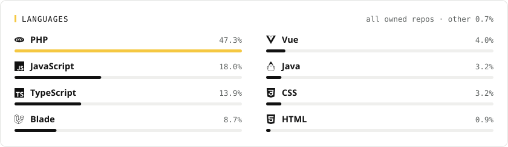
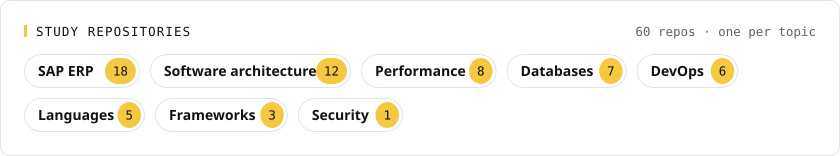

<!-- Generated by `npm run build` from the GitHub API and src/content.mjs. Do not edit by hand. -->

<a href="https://github.com/igor-barral"><picture><source media="(prefers-color-scheme: dark)" srcset="assets/header-dark.svg"></picture></a>

<picture><source media="(prefers-color-scheme: dark)" srcset="assets/overview-dark.svg"></picture>

<picture><source media="(prefers-color-scheme: dark)" srcset="assets/contributions-dark.svg"></picture>

<picture><source media="(prefers-color-scheme: dark)" srcset="assets/languages-dark.svg"></picture>

<picture><source media="(prefers-color-scheme: dark)" srcset="assets/topics-dark.svg"></picture>

<picture><source media="(prefers-color-scheme: dark)" srcset="assets/recent-head-dark.svg"></picture> 
<a href="https://github.com/igor-barral/SAP-Study-Road-Map"><picture><source media="(prefers-color-scheme: dark)" srcset="assets/repo-sap-study-road-map-dark.svg"></picture></a> 
<a href="https://github.com/igor-barral/sap-freight-calculation-case"><picture><source media="(prefers-color-scheme: dark)" srcset="assets/repo-sap-freight-calculation-case-dark.svg"></picture></a> 
<a href="https://github.com/igor-barral/Software-Engineering-Study-Road-Map"><picture><source media="(prefers-color-scheme: dark)" srcset="assets/repo-software-engineering-study-road-map-dark.svg"></picture></a> 
<a href="https://github.com/igor-barral/php-turbo-admin"><picture><source media="(prefers-color-scheme: dark)" srcset="assets/repo-php-turbo-admin-dark.svg"></picture></a> 
<a href="https://github.com/igor-barral/canais-pipeline-site"><picture><source media="(prefers-color-scheme: dark)" srcset="assets/repo-canais-pipeline-site-dark.svg"></picture></a>

<picture><source media="(prefers-color-scheme: dark)" srcset="assets/links-head-dark.svg"></picture> 
<a href="https://igorbarral.com.br"><picture><source media="(prefers-color-scheme: dark)" srcset="assets/link-site-dark.svg"></picture></a>&nbsp;
<a href="https://www.linkedin.com/in/igorbarrall"><picture><source media="(prefers-color-scheme: dark)" srcset="assets/link-linkedin-dark.svg"></picture></a>&nbsp;
<a href="https://youtube.com/@igorbarralltech"><picture><source media="(prefers-color-scheme: dark)" srcset="assets/link-youtube-tech-dark.svg"></picture></a>&nbsp;
<a href="https://youtube.com/@igorbarrallopina"><picture><source media="(prefers-color-scheme: dark)" srcset="assets/link-youtube-opina-dark.svg"></picture></a>&nbsp;
<a href="https://youtube.com/@igorbarrallvlog"><picture><source media="(prefers-color-scheme: dark)" srcset="assets/link-youtube-vlog-dark.svg"></picture></a>&nbsp;
<a href="https://instagram.com/igorbarrall"><picture><source media="(prefers-color-scheme: dark)" srcset="assets/link-instagram-dark.svg"></picture></a>&nbsp;
<a href="https://tiktok.com/@igorbarralltech"><picture><source media="(prefers-color-scheme: dark)" srcset="assets/link-tiktok-dark.svg"></picture></a>&nbsp;
<a href="https://facebook.com/igorbarrall"><picture><source media="(prefers-color-scheme: dark)" srcset="assets/link-facebook-dark.svg"></picture></a>

Data as tables

| Language | Share |
| --- | ---: |
| PHP | 47.3% |
| JavaScript | 18.0% |
| TypeScript | 13.9% |
| Blade | 8.7% |
| Vue | 4.0% |
| Java | 3.2% |
| CSS | 3.2% |
| HTML | 0.9% |
| Other | 0.7% |

| Month | Contributions |
| --- | ---: |
| 2025-12 | 12 |
| 2026-01 | 115 |
| 2026-02 | 13 |
| 2026-03 | 41 |
| 2026-04 | 49 |
| 2026-05 | 7 |
| 2026-06 | 41 |
| 2026-07 | 33 |
| 2026-08 | 77 |
| 2026-09 | 330 |
| 2026-10 | 254 |
| 2026-11 | 93 |

| Study track | Repositories |
| --- | ---: |
| SAP ERP | 18 |
| Software architecture | 12 |
| Performance | 8 |
| Databases | 7 |
| DevOps | 6 |
| Languages | 5 |
| Frameworks | 3 |
| Security | 1 |

